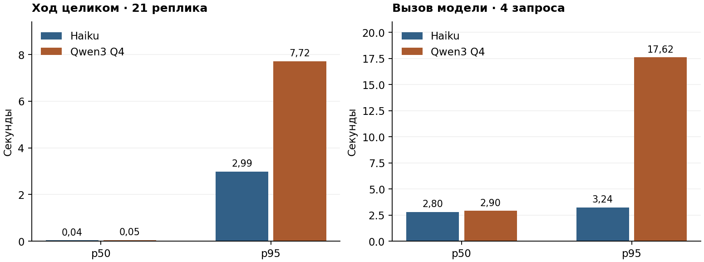

# Haiku и локальная Qwen3 в Softline Store Advisor

Сравнение от 27 ноября 2026 года. Обе модели прошли одну закрытую выборку из 8 вымышленных диалогов и 21 реплики. Ответы проверялись через штатные HTTP-маршруты и worker с отдельной схемой PostgreSQL для каждого профиля. Каталог Softline зафиксирован на 25 ноября 2026 года.

| Метрика | Haiku 5.5 через Polza | Qwen3-4B Instruct 2507, Q4_K_M |
| --- | ---: | ---: |
| Диалоги без ошибок | 8/8 | 8/8 |
| Точный набор предложений или ожидаемое отсутствие товара | 13/13 | 13/13 |
| Ожидаемые факты и источники | 13/13 | 13/13 |
| Уточнение по нужному параметру | 6/6 | 6/6 |
| Решение о передаче менеджеру | 21/21 | 21/21 |
| Передачи с одной записью в очереди и историей | 3/3 | 3/3 |
| Успешные вызовы модели | 4/4 | 4/4 |
| p50 по всем репликам | 0,038 с | 0,048 с |
| p95 по всем репликам | 2,990 с | 7,718 с |
| p50 вызова модели | 2,797 с | 2,902 с |
| p95 вызова модели | 3,240 с | 17,624 с |

При 21 реплике p95 — вторая по длительности реплика. Для четырёх вызовов p95 равен максимуму. Первый структурированный вызов Qwen занял 17,624 с после загрузки весов в память. Три следующих — 2,642–2,931 с. Измерения сделаны последовательно на Apple M3 с 8 ГБ единой памяти. Qwen использовала 3,20 ГБ памяти GPU при контексте 2 048 токенов. Время чата включает обработку HTTP и worker, без интервала проверки очереди в Compose.

Модели вызывались на одних и тех же четырёх репликах. Остальные 17 обработали локальные маршруты агента. Равные результаты подтверждают совместимость второго профиля с проверенными сценариями, а различия в задержке относятся к этому прогону и оборудованию. Работа на реальном трафике потребует отдельного замера.

## Поиск статьи менеджера

Проверка через HTTP начинается с передачи обращения менеджеру, сохранения его приватной реплики и отдельной публикации статьи для SKU. По исходному вопросу «Как обновить список модулей?» воркер находит статью на фразу «Где освежить перечень компонентов EP2-07001?». Так же работает явная отсылка к последней выбранной карточке. Запрос для другого SKU, вопрос без товарной привязки и запрос на удаление возвращаются в обычную обработку. Для проверки использовалась тестовая статья.

## Воспроизведение

Сохраните отдельную закрытую выборку, зафиксируйте SHA-256 и запустите `python -m ml_pipeline.agent_eval.compare_profiles` в окружении проекта с изолированной `TEST_DATABASE_URL`. Скрипт проверяет digest Ollama, прогревает Qwen, выполняет оба профиля и записывает JSON с результатами. В прогоне использован SHA-256 `23be331d444114af81e7a5c76496cc28b3e7e512e0dee8bb15f152784bdfad12`.

[Инструкция запуска и контракт worker](softline-model-profiles.md)
